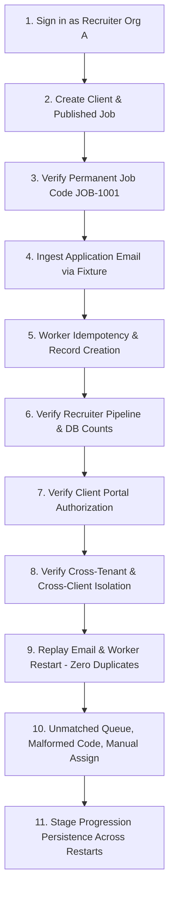

# HiredeskHR — Acceptance Tests & Verification Suite

## 1. Critical End-to-End Acceptance Loop

This test suite serves as the definitive release gate for HiredeskHR. All steps must pass deterministically before production release.

### Test Step Specifications

| Step | Action | Verification Assertion |
| :--- | :--- | :--- |
| **1** | Recruiter signs in to Organization A | Valid session established; `req.user.organizationId` matches Org A; role is `recruiter`. |
| **2** | Recruiter creates Client A1 and Job "Backend Developer" | Job persisted with `status: published`, `clientId: Client A1`, `organizationId: Org A`. |
| **3** | Inspect allocated Job Code | Job Code format matches `JOB-\d+` (e.g. `JOB-1001`). Copy action retrieves exact string. Code cannot be modified. |
| **4** | Simulate email fixture with subject "Application for JOB-1001" and PDF resume | Worker extracts `JOB-1001`, identifies exact job, streams PDF to private bucket. |
| **5** | Inspect persistence records | Exactly 1 `InboundApplication` (status `matched`), 1 `Candidate`, 1 `Application` (stage `Applied`), 1 `Resume` (private path), 1 `StageHistory`, 1 `ActivityLog`. |
| **6** | Load recruiter pipeline in Web UI | Application visible in `Applied` stage. Dashboard metrics incremented via real database query. |
| **7** | Client A1 user signs in to Client Portal | Job and candidate are visible. Candidate profile and resume download are accessible. |
| **8** | Client A2 user and Org B Recruiter attempt to access the candidate and resume | **DENIED (403/404)**. Route ID tampering, direct API calls, and signed URL generation fail with authorization errors. Internal recruiter notes never leak. |
| **9** | Replay the same email message and restart the worker process | Worker detects duplicate `(mailboxId, uidValidity, uid)` and skips. Record counts for Candidate, Application, and Resume remain identical (0 duplicates). |
| **10** | Ingest emails with (a) no code, (b) unknown code `JOB-9999`, (c) malformed code `JOB-ABC`, (d) invalid resume type | All 4 messages enter `InboundApplication` with status `unmatched` or `failed`. Unmatched queue displays reasons. Recruiter manually assigns (a) to `JOB-1001`; application is created cleanly. |
| **11** | Recruiter promotes application stage to `Shortlisted`; restart API & worker | Stage remains `Shortlisted`. `StageHistory` records transition. Persistence survives server restarts. |

---

## 2. Negative Security & Boundary Test Matrix

| Test ID | Route / Operation | Attacker Profile | Input / Action | Expected Result |
| :--- | :--- | :--- | :--- | :--- |
| **SEC-01** | `GET /api/jobs` | Unauthenticated | No Authorization header | `401 Unauthorized` |
| **SEC-02** | `GET /api/jobs/:id` | Recruiter (Org A) | Request Job ID belonging to Org B | `404 Not Found` (no existence leak) |
| **SEC-03** | `GET /api/applications/:id` | Client User (Client 1) | Request Application for Client 2 | `403 Forbidden` / `404 Not Found` |
| **SEC-04** | `GET /api/applications/:id/resume`| Client User (Client 1) | Direct URL guessing for Client 2's resume | `403 Forbidden` |
| **SEC-05** | `POST /api/jobs` | Recruiter (Org A) | Submit payload with `clientId` of Org B | `400 Bad Request` / `403 Forbidden` |
| **SEC-06** | `POST /api/jobs` | Recruiter (Org A) | Attempt to set custom `jobCode` in body | Job code field ignored; generated server-side |
| **SEC-07** | `POST /api/public/apply/:id` | Public applicant | Flood 50 requests in 1 minute | `429 Too Many Requests` (Rate limit) |
| **SEC-08** | `POST /api/public/apply/:id` | Public applicant | Upload `.exe` disguised as `.pdf` | `400 Bad Request` (Invalid file type/magic byte) |
| **SEC-09** | Any endpoint | Inactive user | Valid JWT but `UserProfile.active == false` | `403 Forbidden` |
| **SEC-10** | `GET /api/analytics/dashboard` | Recruiter (Org A) | Attempt to view aggregate metrics of Org B | Scoped to Org A; Org B counts never leak |
| **SEC-11** | `GET /api/analytics/dashboard` | Client User (Client 1) | Attempt to view agency-wide metrics | Scoped to Client 1 assigned jobs only |
| **SEC-12** | `PATCH /api/applications/:id/notes` | Client User (Client 1) | Attempt to mutate `recruiterNotes` | `403 Forbidden` (`FORBIDDEN`) |
| **SEC-13** | `GET /api/applications/:id` | Client User (Client 1) | View application details | `recruiterNotes` is completely redacted (`undefined`) |
| **SEC-14** | `POST /api/applications/:id/stage` | Client User (Client 1) | Transition application in `Applied` stage | `403 Forbidden` (Only permitted in `Client Review`) |
| **SEC-15** | `POST /api/applications/:id/stage` | Recruiter (Org A) | Submit malformed stage enum (e.g. `INVALID`) | `400 Bad Request` (`VALIDATION_ERROR`) |

---

## 3. Phase 5 Acceptance Test Matrix: Recruiter Dashboard, Pipeline & Notes

| Test ID | Module | Scenario / Input | Expected Result | Verified Against |
| :--- | :--- | :--- | :--- | :--- |
| **P5-01** | Analytics | `GET /api/analytics/dashboard` for populated agency | Returns real DB-computed counts for total, published, draft, closed jobs, unique candidates, 7-day recent apps, stage breakdown, and 14-day deadline alerts | Vitest + Live Supabase |
| **P5-02** | Analytics | `GET /api/analytics/dashboard` for empty organization | Returns honest zeros (0 jobs, 0 candidates, 0 apps, empty arrays) without demo/sample data | Vitest |
| **P5-03** | Analytics | Multi-tenant isolation | Org A and Org B query dashboard; counts strictly isolated | Vitest |
| **P5-04** | Pipeline | `GET /api/jobs/:id/pipeline` | Groups applications into 10 canonical stages (`Applied`, `Screening`, `Shortlisted`, `Interview`, `AI Interview`, `Client Review`, `Selected`, `Hired`, `Rejected`, `Withdrawn`) | Vitest + Live Supabase |
| **P5-05** | Stage Transition | `POST /api/applications/:id/stage` with valid stage & reason | Atomically updates `Application.stage`, inserts `StageHistory`, and inserts `ActivityLog` in single transaction | Vitest + Live Supabase |
| **P5-06** | Stage Rollback | Simulated database transaction crash during stage update | Neither `Application.stage` nor `StageHistory` are modified (clean rollback, 500 error) | Vitest |
| **P5-07** | Notes Security | Recruiter sets internal notes via `PATCH /api/applications/:id/notes` | Note persisted, internal `ActivityLog` recorded | Vitest + Live Supabase |
| **P5-08** | Notes Security | Client reads application with recruiter notes present | `recruiterNotes` is stripped/undefined; `clientFeedback` remains readable | Vitest + Live Supabase |
| **P5-09** | Notes Security | Client updates feedback via `PATCH /api/applications/:id/notes` | `clientFeedback` persisted; `client_visible` activity log created; recruiter notes untouched | Vitest + Live Supabase |
| **P5-10** | Candidate Profile | `GET /api/candidates/:id` | Returns personal details, resumes, and multi-job applications with independent stage histories | Vitest + Live Supabase |
| **P5-11** | Candidate Search | `GET /api/candidates?search=...&page=1&limit=10` | Performs paginated search across name, email, phone, location | Vitest |

---

## 3. Idempotency & Failure Recovery Verification

1. **Worker Network Interruption**:
   - Disconnect IMAP socket during message processing.
   - Reconnect with exponential backoff.
   - Resume processing uncommitted messages without duplication.
2. **Database Transaction Rollback**:
   - If resume storage fails after candidate creation, database transaction rolls back candidate creation or marks `InboundApplication` as `failed` for safe retry.
3. **Application Deduplication**:
   - Unique constraint on `(jobId, candidateId)` prevents double-submission if applicant submits twice.

---

## 4. Phase 6 Acceptance Test Matrix: Client Portal, Actions & Isolation Hardening

| Test ID | Module | Scenario / Input | Expected Result | Verified Against |
| :--- | :--- | :--- | :--- | :--- |
| **SEC-16** | Client Scope | Recruiter calls `GET /api/client-portal/jobs` | `403 Forbidden` (`FORBIDDEN`) — restricted to client role | Vitest (`clientPortal.test.ts`) |
| **SEC-17** | Cross-Client Job | Client 1 calls `GET /api/client-portal/jobs/:jobId` for Job of Client 2 | `404 Not Found` (Non-disclosing, zero disclosure) | Vitest + Live Supabase |
| **SEC-18** | Cross-Client App | Client 1 calls `GET /api/client-portal/applications/:id` for Candidate of Client 2 | `404 Not Found` (Zero disclosure of applicant existence) | Vitest + Live Supabase |
| **SEC-19** | DTO Protection | Client calls `GET /api/client-portal/applications/:id` with sensitive notes | `recruiterNotes` is completely redacted (`undefined`) | Vitest + Live Supabase |
| **SEC-20** | Resume Storage Path | Client calls `GET /api/client-portal/applications/:id` | `storagePath`, `bucket`, `checksum` are stripped from `resumes` array | Vitest (`clientPortal.test.ts`) |
| **SEC-21** | Shortlist Action | Client calls `POST /api/client-portal/applications/:id/shortlist` on `Client Review` app | Transitions to `Shortlisted`, writes `StageHistory` and `ActivityLog` atomically | Vitest + Live Supabase |
| **SEC-22** | Shortlist State Gate | Client calls `POST .../shortlist` on `Applied` or `Interview` app | `403 Forbidden` — client cannot bypass review stage | Vitest (`clientPortal.test.ts`) |
| **SEC-23** | Shortlist Idempotency | Client calls `POST .../shortlist` twice on same app | Second call returns cleanly without creating duplicate stage history | Vitest (`clientPortal.test.ts`) |
| **SEC-24** | Reject Action | Client calls `POST /api/client-portal/applications/:id/reject` with valid reason | Transitions to `Rejected`, writes `StageHistory` and `ActivityLog` atomically | Vitest + Live Supabase |
| **SEC-25** | Reject State Gate | Client calls `POST .../reject` on non-review application | `403 Forbidden` — client cannot reject outside review/shortlist | Vitest (`clientPortal.test.ts`) |
| **SEC-26** | Interview Request | Client calls `POST .../request-interview` with time preferences & notes | Persists `InterviewRequest` with `status: 'pending'`, returns explicit coordinating message | Vitest + Live Supabase |
| **SEC-27** | Interview Honesty | Response inspection for `request-interview` | Must NOT claim scheduled event or sent invite; message confirms pending coordinator status | Vitest + Live Supabase |
| **SEC-28** | Interview Idempotency| Client calls `POST .../request-interview` twice | Second call returns existing pending request without duplicate DB rows | Vitest (`clientPortal.test.ts`) |
| **SEC-29** | Signed Resume URL | Client calls `GET /api/client-portal/applications/:id/resume` | Issues authorized 60-second signed URL for download | Vitest (`clientPortal.test.ts`) |
| **SEC-30** | Cross-Client Resume | Client 1 calls `GET .../resume` for application of Client 2 | `404 Not Found` (Zero resume leak) | Vitest (`clientPortal.test.ts`) |

---

## 5. Phase 7 Acceptance Test Matrix: Interview Scheduling, Calendar Events & SMTP Outbox

| Test ID | Module | Scenario / Input | Expected Result | Verified Against |
| :--- | :--- | :--- | :--- | :--- |
| **INT-01** | Scheduling | Recruiter schedules valid interview with start < end time | Creates `Interview` in `scheduled` status, queues `OutboundCommunication` records, logs activity | Vitest (`interviews.test.ts`) |
| **INT-02** | Time Validation | Recruiter supplies `endAt <= startAt` | `400 BAD_REQUEST` with validation error message | Vitest (`interviews.test.ts`) |
| **INT-03** | Double Booking | Recruiter books interviewer during existing active interview interval | `409 Conflict` (`INTERVIEWER_CONFLICT`), transaction rejected | Vitest (`interviews.test.ts`) |
| **INT-04** | Client Request Fulfill| Recruiter passes `interviewRequestId` during scheduling | In atomic transaction, creates interview and updates `InterviewRequest` to `scheduled` with `interviewId` linked | Vitest (`interviews.test.ts`) |
| **INT-05** | Role Authorization | Client role attempts `POST /api/interviews` | `403 Forbidden` (`FORBIDDEN`) — scheduling restricted to recruiter roles | Vitest (`interviews.test.ts`) |
| **INT-06** | Cross-Tenant Leak | Recruiter in Org A requests interview belonging to Org B | `404 Not Found` (Zero disclosure of other tenant's interview) | Vitest (`interviews.test.ts`) |
| **INT-07** | Client Scoping | Client calls `GET /api/client-portal/interviews` | Returns only interviews for jobs assigned to caller's `clientId` | Vitest (`interviews.test.ts`) |
| **INT-08** | Client Notes Redact | Client calls `GET /api/client-portal/interviews/:id` | `interviewerNotes` is redacted (`undefined`) in response | Vitest (`interviews.test.ts`) |
| **INT-09** | Reschedule Sequence | Recruiter reschedules interview to new time slot | Increments `sequence` (0 -> 1), creates `InterviewHistory`, updates outbox | Vitest (`interviews.test.ts`) |
| **INT-10** | Reschedule Conflict | Recruiter reschedules interviewer into another existing booking | `409 Conflict` (`INTERVIEWER_CONFLICT`), original time preserved | Vitest (`interviews.test.ts`) |
| **INT-11** | Cancellation | Recruiter cancels interview with reason | Status set to `cancelled`, creates cancellation outbox email with `METHOD:CANCEL` | Vitest (`interviews.test.ts`) |
| **INT-12** | .ICS Export | User downloads `/api/interviews/:id/ics` | Emits RFC 5545 calendar with stable UID, sequence, UTC timestamps | Vitest (`interviews.test.ts`) |
| **INT-13** | XSS Escaping | Email template with `<script>` in candidate name or job title | HTML entities escaped (`&lt;script&gt;`), script execution neutralized | Vitest (`email.test.ts`) |
| **INT-14** | SMTP Missing | Email service triggered without SMTP configuration | Records `status: 'failed'` with code `SMTP_NOT_CONFIGURED`, does not throw | Vitest (`email.test.ts`) |
| **INT-15** | Transient Retry | Outbox processor encounters transient socket timeout (ETIMEDOUT) | Increments attempt count and schedules exponential backoff retry | Vitest (`email.test.ts`) |
| **INT-16** | Permanent Failure | Outbox processor encounters 550 Relay Denied | Marks communication as permanently `failed` without infinite retry loop | Vitest (`email.test.ts`) |
| **INT-17** | Manual Retry | Recruiter triggers manual retry on failed communication | Re-attempts delivery via outbox and returns result | Vitest (`email.test.ts`) |

