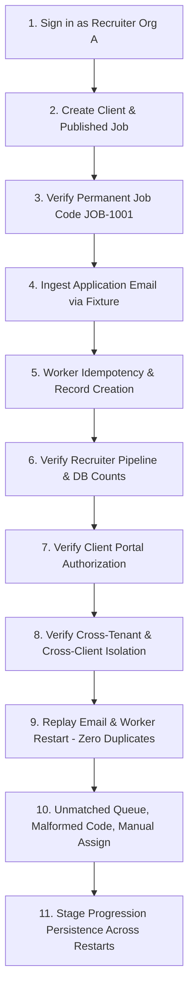

# HiredeskHR — Acceptance Tests & Verification Suite

## 1. Critical End-to-End Acceptance Loop

This test suite serves as the definitive release gate for HiredeskHR. All steps must pass deterministically before production release.

### Test Step Specifications

| Step | Action | Verification Assertion |
| :--- | :--- | :--- |
| **1** | Recruiter signs in to Organization A | Valid session established; `req.user.organizationId` matches Org A; role is `recruiter`. |
| **2** | Recruiter creates Client A1 and Job "Backend Developer" | Job persisted with `status: published`, `clientId: Client A1`, `organizationId: Org A`. |
| **3** | Inspect allocated Job Code | Job Code format matches `JOB-\d+` (e.g. `JOB-1001`). Copy action retrieves exact string. Code cannot be modified. |
| **4** | Simulate email fixture with subject "Application for JOB-1001" and PDF resume | Worker extracts `JOB-1001`, identifies exact job, streams PDF to private bucket. |
| **5** | Inspect persistence records | Exactly 1 `InboundApplication` (status `matched`), 1 `Candidate`, 1 `Application` (stage `Applied`), 1 `Resume` (private path), 1 `StageHistory`, 1 `ActivityLog`. |
| **6** | Load recruiter pipeline in Web UI | Application visible in `Applied` stage. Dashboard metrics incremented via real database query. |
| **7** | Client A1 user signs in to Client Portal | Job and candidate are visible. Candidate profile and resume download are accessible. |
| **8** | Client A2 user and Org B Recruiter attempt to access the candidate and resume | **DENIED (403/404)**. Route ID tampering, direct API calls, and signed URL generation fail with authorization errors. Internal recruiter notes never leak. |
| **9** | Replay the same email message and restart the worker process | Worker detects duplicate `(mailboxId, uidValidity, uid)` and skips. Record counts for Candidate, Application, and Resume remain identical (0 duplicates). |
| **10** | Ingest emails with (a) no code, (b) unknown code `JOB-9999`, (c) malformed code `JOB-ABC`, (d) invalid resume type | All 4 messages enter `InboundApplication` with status `unmatched` or `failed`. Unmatched queue displays reasons. Recruiter manually assigns (a) to `JOB-1001`; application is created cleanly. |
| **11** | Recruiter promotes application stage to `Shortlisted`; restart API & worker | Stage remains `Shortlisted`. `StageHistory` records transition. Persistence survives server restarts. |

---

## 2. Negative Security & Boundary Test Matrix

| Test ID | Route / Operation | Attacker Profile | Input / Action | Expected Result |
| :--- | :--- | :--- | :--- | :--- |
| **SEC-01** | `GET /api/jobs` | Unauthenticated | No Authorization header | `401 Unauthorized` |
| **SEC-02** | `GET /api/jobs/:id` | Recruiter (Org A) | Request Job ID belonging to Org B | `404 Not Found` (no existence leak) |
| **SEC-03** | `GET /api/applications/:id` | Client User (Client 1) | Request Application for Client 2 | `403 Forbidden` / `404 Not Found` |
| **SEC-04** | `GET /api/applications/:id/resume`| Client User (Client 1) | Direct URL guessing for Client 2's resume | `403 Forbidden` |
| **SEC-05** | `POST /api/jobs` | Recruiter (Org A) | Submit payload with `clientId` of Org B | `400 Bad Request` / `403 Forbidden` |
| **SEC-06** | `POST /api/jobs` | Recruiter (Org A) | Attempt to set custom `jobCode` in body | Job code field ignored; generated server-side |
| **SEC-07** | `POST /api/public/apply/:id` | Public applicant | Flood 50 requests in 1 minute | `429 Too Many Requests` (Rate limit) |
| **SEC-08** | `POST /api/public/apply/:id` | Public applicant | Upload `.exe` disguised as `.pdf` | `400 Bad Request` (Invalid file type/magic byte) |
| **SEC-09** | Any endpoint | Inactive user | Valid JWT but `UserProfile.active == false` | `403 Forbidden` |

---

## 3. Idempotency & Failure Recovery Verification

1. **Worker Network Interruption**:
   - Disconnect IMAP socket during message processing.
   - Reconnect with exponential backoff.
   - Resume processing uncommitted messages without duplication.
2. **Database Transaction Rollback**:
   - If resume storage fails after candidate creation, database transaction rolls back candidate creation or marks `InboundApplication` as `failed` for safe retry.
3. **Application Deduplication**:
   - Unique constraint on `(jobId, candidateId)` prevents double-submission if applicant submits twice.
