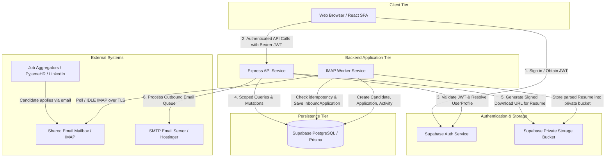

# HiredeskHR — System Architecture

## 1. Monorepo Organization

```text
hiredeskhr/
├── apps/
│   ├── web/                     # React + Vite + TypeScript Frontend
│   │   ├── src/
│   │   │   ├── components/      # UI components & design system tokens
│   │   │   ├── pages/           # Routed views (Dashboard, Jobs, Pipeline, ClientPortal)
│   │   │   ├── context/         # AuthContext & Session management
│   │   │   ├── lib/             # Supabase client & API client wrapper
│   │   │   └── types/           # Frontend-specific types
│   │   ├── package.json
│   │   └── vite.config.ts
│   ├── api/                     # Express + TypeScript Central API Gateway
│   │   ├── src/
│   │   │   ├── config/          # Environment variables & constants
│   │   │   ├── middleware/      # Auth, RBAC, tenantContext, requestLogger, rateLimit, errorHandler
│   │   │   ├── routes/          # Express route definitions (auth, jobs, applications, candidates, clients, unmatched)
│   │   │   ├── services/        # Business logic & tenant-scoped database interactions
│   │   │   ├── utils/           # Structured logger (Pino with redaction), responses
│   │   │   └── app.ts / server.ts
│   │   ├── package.json
│   │   └── tsconfig.json
│   └── worker/                  # Dedicated IMAP Ingestion Service
│       ├── src/
│       │   ├── imap/            # IMAP client (imapflow), listener, exponential reconnect
│       │   ├── parser/          # MIME parser (mailparser), Job Code normalizer
│       │   ├── pipeline/        # Ingestion processor, idempotency verification, storage client
│       │   └── index.ts         # Worker process runner & graceful shutdown handlers
│       ├── package.json
│       └── tsconfig.json
├── packages/
│   ├── database/                # Prisma schema, migrations, and Prisma client factory
│   │   ├── prisma/
│   │   │   ├── schema.prisma
│   │   │   └── migrations/
│   │   ├── src/
│   │   │   └── index.ts         # Singleton client export with tenant-safe helpers
│   │   └── package.json
│   └── shared/                  # Common TypeScript enums, contracts, and Zod schemas
│       ├── src/
│       │   ├── enums.ts         # UserRole, JobStatus, ApplicationStage, InboundStatus
│       │   ├── schemas/         # Shared Zod validation schemas
│       │   └── index.ts
│       └── package.json
├── supabase/
│   └── migrations/              # SQL for RLS policies, sequences, triggers, private buckets
├── docs/                        # Complete design & specification documents
├── .env.example                 # Documented environment templates
├── .gitignore
├── package.json                 # Workspaces definition & root lifecycle scripts
└── README.md
```

---

## 2. Component Boundaries & Data Flow



---

## 3. API Architecture & Request Lifecycle

Every inbound request to `apps/api` traverses a standardized middleware pipeline:

1. **Request Correlation**: Attaches `x-request-id` (UUIDv4) to `req` and response headers.
2. **Security Headers**: `helmet` enforces strict HTTP headers (HSTS, Content-Security-Policy, X-Frame-Options).
3. **CORS**: Validates origin against configured `CORS_ORIGIN` whitelist.
4. **Rate Limiting**: `express-rate-limit` prevents brute-force abuse on public endpoints.
5. **Structured Request Logging**: `pino-http` logs request method, route, status code, and latency. Sensitive headers (`authorization`, `cookie`) and payloads are redacted.
6. **Authentication & Tenant Scoping**:
   - Validates the Supabase JWT.
   - Loads `UserProfile` (cached or fetched) to determine `organizationId`, `role`, and optional `clientId`.
   - Attaches `req.user` context.
7. **Role-Based Authorization (`requireRole`)**: Checks caller permissions.
8. **Zod Validation**: Validates `params`, `query`, and `body` schemas before route handlers execute.
9. **Standard Response Envelope**:
   - Success: `{ "success": true, "data": { ... } }`
   - Failure: `{ "success": false, "error": { "code": "NOT_FOUND", "message": "...", "details": [...] } }`

---

## 4. Background Worker Architecture (IMAP Ingestion)

1. **Persistent Execution**: Node.js service running `imapflow` with IDLE / polling loop.
2. **TLS Security**: Secure IMAP connection over port 993 with strict TLS validation.
3. **Idempotency Strategy**:
   - Mailbox identifier + `UIDVALIDITY` + `UID` + `Message-ID`.
   - Before downloading or parsing heavy attachments, checks if `(mailboxId, uidValidity, uid)` exists in `InboundApplication`.
   - If already processed or matched, skips message with debug log.
4. **MIME Parsing**: Uses `mailparser` to stream message headers and attachments.
5. **Resume File Handling**:
   - Validates MIME (`application/pdf`, `application/msword`, `application/vnd.openxmlformats-officedocument.wordprocessingml.document`).
   - Limits file size to 10MB.
   - Generates random object path: `resumes/{organizationId}/{candidateId}/{uuid}.{ext}`.
   - Uploads directly to Supabase Private Storage using service key.
6. **Fault Tolerance & Graceful Shutdown**:
   - Listens for `SIGTERM` / `SIGINT`.
   - Closes active IMAP mailbox connections cleanly and flushes structured logs before exiting.
   - Failed messages are saved with status `failed` or `unmatched` and error detail.

---

## 5. Structured Logging & PII Redaction

Structured logging uses `pino`:
- Log format in development: `pino-pretty` with colors.
- Log format in production: newline-delimited JSON.
- **Redaction Rules**:
  - `req.headers.authorization`
  - `password`, `token`, `secret`, `apiKey`
  - Email bodies (HTML and raw text)
  - Extracted resume text beyond metadata summary
  - Candidate phone numbers in audit logs

---

## 6. Interview Scheduling & Communications Outbox Architecture (Phase 7)

1. **Transactional Outbox Pattern**:
   - When an interview is scheduled, rescheduled, or cancelled, email notifications are written to `OutboundCommunication` in the same database transaction.
   - Guaranteed against ghost bookings: if the database transaction aborts, no emails are dispatched; if email fails, the interview record is not lost.
2. **SMTP Transport & Resilience**:
   - Nodemailer configured via TLS / port 465 or STARTTLS / port 587.
   - Transient failure handling: connection resets, timeouts (ETIMEDOUT, ECONNRESET, 421/450/451) trigger exponential backoff.
   - Permanent failure handling: invalid recipients, relay rejection (550/553) immediately fail without infinite retry loops.
   - Unconfigured safety: If SMTP variables are missing, records are marked `status: 'failed'` with code `SMTP_NOT_CONFIGURED` without crashing the application.
3. **Pure RFC 5545 iCalendar (.ics) Engine**:
   - Clean UTF-8 `.ics` generation adhering strictly to RFC 5545.
   - Stable UID (`interview-{id}@hiredeskhr.com`).
   - Sequence tracking (`SEQUENCE: 0` for initial booking, incremented on reschedule).
   - Method declarations: `METHOD:REQUEST` for invites, `METHOD:CANCEL` for cancellations with `STATUS:CANCELLED`.
   - Attached as `text/calendar; method=...` MIME part in emails and accessible via authenticated download routes.
4. **Client Portal Hardening**:
   - Client users can access interviews strictly for jobs where `job.clientId == caller.clientId`.
   - Recruiter notes are stripped at the service layer prior to response serialization.
   - Client access to interview actions is strictly read-only.

