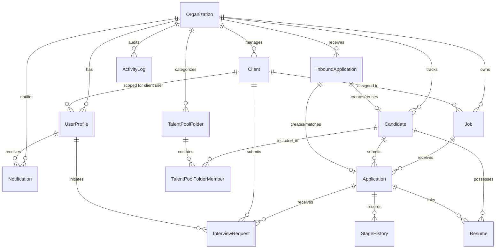

# HiredeskHR — Data Model Specification

## 1. Entity Relationship Diagram (ERD)



---

## 2. Global Job Code Generation Engine

### Sequence-Based Atomic Allocation
Job Codes follow the format: `JOB-1001`, `JOB-1002`, `JOB-1003`, etc.
To prevent concurrency race conditions, table row count calculation is strictly prohibited. Job Codes are allocated atomically via PostgreSQL:

```sql
CREATE SEQUENCE IF NOT EXISTS job_code_seq START WITH 1001 INCREMENT BY 1;

-- Allocation function
CREATE OR REPLACE FUNCTION generate_next_job_code() RETURNS text AS $$
BEGIN
    RETURN 'JOB-' || nextval('job_code_seq')::text;
END;
$$ LANGUAGE plpgsql;
```

### Constraints & Immutability
- Unique index on `Job(jobCode)`.
- Database trigger prevents updates to `Job.jobCode` once created.

---

## 3. Detailed Entity Schemas

### 3.1 Organization
Top-level multi-tenant boundary.
- `id`: UUID (Primary Key, default `gen_random_uuid()`)
- `name`: VarChar(255) NOT NULL
- `slug`: VarChar(100) UNIQUE NOT NULL
- `status`: VarChar(50) DEFAULT 'active' (`active`, `suspended`)
- `createdAt`: Timestamp with time zone DEFAULT now()
- `updatedAt`: Timestamp with time zone DEFAULT now()

### 3.2 UserProfile
Maps 1-to-1 to a Supabase Auth `auth.users.id`.
- `id`: UUID (Primary Key, references `auth.users.id`)
- `organizationId`: UUID (Nullable only for platform `super_admin`)
- `role`: VarChar(50) NOT NULL (`super_admin`, `manager`, `recruiter`, `client`)
- `clientId`: UUID NULL (Required when role is `client`)
- `firstName`: VarChar(100) NOT NULL
- `lastName`: VarChar(100) NOT NULL
- `email`: VarChar(255) NOT NULL
- `active`: Boolean DEFAULT true
- `createdAt`: Timestamp with time zone DEFAULT now()
- `updatedAt`: Timestamp with time zone DEFAULT now()
- **Indexes**: `(organizationId)`, `(clientId)`, `(email)`

### 3.3 Client
Company for whom recruitment services are provided.
- `id`: UUID (Primary Key)
- `organizationId`: UUID NOT NULL (FK -> `Organization.id`)
- `name`: VarChar(255) NOT NULL
- `contactEmail`: VarChar(255) NOT NULL
- `contactPhone`: VarChar(50) NULL
- `status`: VarChar(50) DEFAULT 'active'
- `createdAt`: Timestamp with time zone DEFAULT now()
- `updatedAt`: Timestamp with time zone DEFAULT now()
- **Indexes**: `(organizationId, name)`

### 3.4 Job
Open vacancy created by the agency.
- `id`: UUID (Primary Key)
- `organizationId`: UUID NOT NULL (FK -> `Organization.id`)
- `clientId`: UUID NOT NULL (FK -> `Client.id`)
- `jobCode`: VarChar(50) UNIQUE NOT NULL (e.g. `JOB-1001`)
- `title`: VarChar(255) NOT NULL
- `department`: VarChar(100) NULL
- `employmentType`: VarChar(50) NOT NULL (`full_time`, `part_time`, `contract`, `internship`)
- `workplaceModel`: VarChar(50) NOT NULL (`remote`, `on_site`, `hybrid`)
- `country`: VarChar(100) NOT NULL
- `currency`: VarChar(10) DEFAULT 'USD'
- `salaryMin`: Decimal(12,2) NULL
- `salaryMax`: Decimal(12,2) NULL
- `experienceYears`: Int DEFAULT 0
- `openings`: Int DEFAULT 1
- `deadline`: Timestamp with time zone NULL
- `education`: VarChar(255) NULL
- `skills`: Text[] DEFAULT '{}'
- `description`: Text NOT NULL
- `requirements`: Text NULL
- `status`: VarChar(50) DEFAULT 'draft' (`draft`, `published`, `closed`)
- `applicationFormConfig`: JSONB DEFAULT '{}'
- `createdBy`: UUID NOT NULL
- `createdAt`: Timestamp with time zone DEFAULT now()
- `updatedAt`: Timestamp with time zone DEFAULT now()
- **Indexes**: `(organizationId, status)`, `(clientId)`, `(jobCode)`

### 3.5 Candidate
Represents an applicant identity, reusable across jobs within the organization.
- `id`: UUID (Primary Key)
- `organizationId`: UUID NOT NULL (FK -> `Organization.id`)
- `candidateCode`: VarChar(50) NOT NULL
- `normalizedEmail`: VarChar(255) NOT NULL
- `name`: VarChar(255) NOT NULL
- `phone`: VarChar(50) NULL
- `location`: VarChar(255) NULL
- `country`: VarChar(100) NULL
- `skills`: Text[] DEFAULT '{}'
- `education`: JSONB DEFAULT '[]'
- `experience`: JSONB DEFAULT '[]'
- `sourceMetadata`: JSONB DEFAULT '{}'
- `notes`: Text NULL (Internal recruiter notes)
- `createdAt`: Timestamp with time zone DEFAULT now()
- `updatedAt`: Timestamp with time zone DEFAULT now()
- **Constraints**: UNIQUE `(organizationId, normalizedEmail)`

### 3.6 Application
A candidate's job-specific hiring process.
- `id`: UUID (Primary Key)
- `candidateId`: UUID NOT NULL (FK -> `Candidate.id`)
- `jobId`: UUID NOT NULL (FK -> `Job.id`)
- `organizationId`: UUID NOT NULL (FK -> `Organization.id`)
- `clientId`: UUID NOT NULL (FK -> `Client.id`)
- `stage`: VarChar(50) DEFAULT 'Applied'
- `source`: VarChar(100) DEFAULT 'direct' (`direct`, `email_imap`, `pyjamahr`, `manual_entry`)
- `appliedAt`: Timestamp with time zone DEFAULT now()
- `status`: VarChar(50) DEFAULT 'active' (`active`, `archived`)
- `answers`: JSONB DEFAULT '{}'
- `recruiterNotes`: Text NULL
- `clientFeedback`: Text NULL
- `createdAt`: Timestamp with time zone DEFAULT now()
- `updatedAt`: Timestamp with time zone DEFAULT now()
- **Constraints**: UNIQUE `(jobId, candidateId)` (Guarantees idempotency for duplicate application submissions)
- **Indexes**: `(organizationId, jobId, stage)`, `(clientId, stage)`

### 3.7 Resume
Private resume documents.
- `id`: UUID (Primary Key)
- `candidateId`: UUID NOT NULL (FK -> `Candidate.id`)
- `applicationId`: UUID NULL (FK -> `Application.id`)
- `bucket`: VarChar(100) DEFAULT 'resumes'
- `storagePath`: VarChar(500) NOT NULL
- `originalFilename`: VarChar(255) NOT NULL
- `safeFilename`: VarChar(255) NOT NULL
- `contentType`: VarChar(100) NOT NULL
- `fileSize`: Int NOT NULL
- `checksum`: VarChar(64) NOT NULL (SHA-256)
- `extractedText`: Text NULL
- `parsingStatus`: VarChar(50) DEFAULT 'pending' (`pending`, `parsed`, `failed`)
- `parsingError`: Text NULL
- `uploadedAt`: Timestamp with time zone DEFAULT now()
- **Indexes**: `(candidateId)`, `(applicationId)`, `(checksum)`

### 3.8 InboundApplication
Audit and idempotency record for IMAP message processing.
- `id`: UUID (Primary Key)
- `mailboxId`: VarChar(100) NOT NULL
- `uidValidity`: BigInt NOT NULL
- `uid`: BigInt NOT NULL
- `messageId`: VarChar(255) NULL
- `subject`: VarChar(500) NOT NULL
- `senderEmail`: VarChar(255) NOT NULL
- `senderName`: VarChar(255) NULL
- `recipientEmail`: VarChar(255) NOT NULL
- `receivedAt`: Timestamp with time zone NOT NULL
- `extractedJobCode`: VarChar(50) NULL
- `matchedJobId`: UUID NULL
- `matchedOrgId`: UUID NULL
- `status`: VarChar(50) DEFAULT 'received' (`received`, `processing`, `matched`, `unmatched`, `failed`, `retrying`, `manually_assigned`, `ignored`)
- `failureReason`: Text NULL
- `attemptCount`: Int DEFAULT 0
- `processedAt`: Timestamp with time zone NULL
- `linkedCandidateId`: UUID NULL
- `linkedApplicationId`: UUID NULL
- `createdAt`: Timestamp with time zone DEFAULT now()
- `updatedAt`: Timestamp with time zone DEFAULT now()
- **Constraints**: UNIQUE `(mailboxId, uidValidity, uid)`

### 3.9 StageHistory
Append-only log of application stage progressions.
- `id`: UUID (Primary Key)
- `applicationId`: UUID NOT NULL (FK -> `Application.id`)
- `previousStage`: VarChar(50) NOT NULL
- `nextStage`: VarChar(50) NOT NULL
- `actorId`: UUID NULL (FK -> `UserProfile.id`)
- `reason`: Text NULL
- `timestamp`: Timestamp with time zone DEFAULT now()
- **Indexes**: `(applicationId, timestamp)`

### 3.10 ActivityLog
System-wide audit trail.
- `id`: UUID (Primary Key)
- `organizationId`: UUID NOT NULL (FK -> `Organization.id`)
- `actorId`: UUID NULL
- `entityType`: VarChar(50) NOT NULL (`Job`, `Candidate`, `Application`, `InboundApplication`, `Client`)
- `entityId`: UUID NOT NULL
- `action`: VarChar(100) NOT NULL
- `details`: JSONB DEFAULT '{}'
- `visibility`: VarChar(50) DEFAULT 'internal' (`internal`, `client_visible`)
- `timestamp`: Timestamp with time zone DEFAULT now()
- **Indexes**: `(organizationId, timestamp)`, `(organizationId, visibility)`

### 3.11 InterviewRequest
Persisted interview request record submitted by an authenticated client user for an application.
- `id`: UUID (Primary Key, default `gen_random_uuid()`)
- `applicationId`: UUID NOT NULL (FK -> `Application.id`, onDelete Cascade)
- `jobId`: UUID NOT NULL (FK -> `Job.id`, onDelete Cascade)
- `organizationId`: UUID NOT NULL (FK -> `Organization.id`, onDelete Cascade)
- `clientId`: UUID NOT NULL (FK -> `Client.id`, onDelete Cascade)
- `requestedById`: UUID NULL (FK -> `UserProfile.id`, onDelete SetNull)
- `interviewId`: UUID NULL (FK -> `Interview.id`, onDelete SetNull) - Set when fulfilled into a scheduled interview
- `status`: VarChar(50) DEFAULT 'pending' (`pending`, `scheduled`, `completed`, `cancelled`)
- `preferredTimes`: JSONB DEFAULT '[]' (Array of proposed time slots)
- `notes`: Text NULL (Specific context or notes from client)
- `createdAt`: Timestamp with time zone DEFAULT now()
- `updatedAt`: Timestamp with time zone DEFAULT now()
- **Indexes**: `(applicationId)`, `(organizationId, clientId)`, `(jobId)`, `(status)`, `(createdAt)`

### 3.12 Interview (Phase 7)
Scheduled interview booking linking all hiring stakeholders.
- `id`: UUID (Primary Key, default `gen_random_uuid()`)
- `organizationId`: UUID NOT NULL (FK -> `Organization.id`, onDelete Cascade)
- `clientId`: UUID NOT NULL (FK -> `Client.id`, onDelete Cascade)
- `jobId`: UUID NOT NULL (FK -> `Job.id`, onDelete Cascade)
- `applicationId`: UUID NOT NULL (FK -> `Application.id`, onDelete Cascade)
- `candidateId`: UUID NOT NULL (FK -> `Candidate.id`, onDelete Cascade)
- `interviewerUserProfileId`: UUID NOT NULL (FK -> `UserProfile.id`, onDelete Restrict)
- `scheduledByUserProfileId`: UUID NULL (FK -> `UserProfile.id`, onDelete SetNull)
- `type`: VarChar(50) DEFAULT 'video' (`video`, `phone`, `in_person`, `technical_assessment`, `culture_fit`)
- `status`: VarChar(50) DEFAULT 'scheduled' (`scheduled`, `completed`, `cancelled`, `no_show`, `rescheduled`)
- `startAt`: Timestamp with time zone NOT NULL
- `endAt`: Timestamp with time zone NOT NULL
- `timeZone`: VarChar(50) DEFAULT 'UTC'
- `meetingProvider`: VarChar(50) NULL (`google_meet`, `microsoft_teams`, `zoom`, `phone`, `custom`)
- `meetingUrl`: VarChar(500) NULL
- `location`: VarChar(500) NULL
- `sequence`: Int DEFAULT 0 (Incremented on each reschedule for RFC 5545 calendar sequence compliance)
- `interviewerNotes`: Text NULL (Confidential internal preparation & evaluation notes; strictly redacted from client portal)
- `feedback`: Text NULL (Feedback summary)
- `result`: VarChar(50) NULL (`passed`, `failed`, `on_hold`)
- `cancellationReason`: Text NULL
- `createdAt`: Timestamp with time zone DEFAULT now()
- `updatedAt`: Timestamp with time zone DEFAULT now()
- **Indexes**: `(organizationId, interviewerUserProfileId, startAt, endAt)`, `(organizationId, clientId, startAt)`, `(applicationId)`, `(status)`

### 3.13 InterviewHistory (Phase 7)
Append-only lifecycle and reschedule audit history for interviews.
- `id`: UUID (Primary Key, default `gen_random_uuid()`)
- `interviewId`: UUID NOT NULL (FK -> `Interview.id`, onDelete Cascade)
- `actorUserProfileId`: UUID NULL (FK -> `UserProfile.id`, onDelete SetNull)
- `previousStatus`: VarChar(50) NOT NULL
- `nextStatus`: VarChar(50) NOT NULL
- `startAt`: Timestamp with time zone NOT NULL
- `endAt`: Timestamp with time zone NOT NULL
- `timeZone`: VarChar(50) NOT NULL
- `reason`: Text NULL
- `notes`: Text NULL
- `createdAt`: Timestamp with time zone DEFAULT now()
- **Indexes**: `(interviewId, createdAt)`

### 3.14 OutboundCommunication (Phase 7)
Durable outbound email outbox for interview invitations, calendar events, updates, and cancellations.
- `id`: UUID (Primary Key, default `gen_random_uuid()`)
- `organizationId`: UUID NOT NULL (FK -> `Organization.id`, onDelete Cascade)
- `interviewId`: UUID NULL (FK -> `Interview.id`, onDelete SetNull)
- `recipientEmail`: VarChar(255) NOT NULL
- `recipientName`: VarChar(255) NULL
- `recipientType`: VarChar(50) NOT NULL (`candidate`, `interviewer`, `client`, `recruiter`)
- `templateId`: VarChar(100) NOT NULL (`interview_invitation_candidate`, `interview_notice_client`, `interview_rescheduled_candidate`, `interview_rescheduled_client`, `interview_cancelled_candidate`, `interview_cancelled_client`)
- `subject`: VarChar(255) NOT NULL
- `bodyHtml`: Text NOT NULL
- `bodyText`: Text NOT NULL
- `status`: VarChar(50) DEFAULT 'queued' (`queued`, `sending`, `sent`, `failed`)
- `providerMessageId`: VarChar(255) NULL
- `attemptCount`: Int DEFAULT 0
- `lastAttemptAt`: Timestamp with time zone NULL
- `sentAt`: Timestamp with time zone NULL
- `failedAt`: Timestamp with time zone NULL
- `errorCode`: VarChar(100) NULL
- `errorMessage`: Text NULL
- `metadata`: JSONB DEFAULT '{}'
- `createdAt`: Timestamp with time zone DEFAULT now()
- `updatedAt`: Timestamp with time zone DEFAULT now()
- **Indexes**: `(organizationId, status)`, `(interviewId)`, `(recipientEmail)`, `(createdAt)`

### 3.15 TalentPoolFolder (Phase 8)
Custom organization-scoped categorization folders for candidate rediscovery and sourcing.
- `id`: UUID (Primary Key, default `gen_random_uuid()`)
- `organizationId`: UUID NOT NULL (FK -> `Organization.id`, onDelete Cascade)
- `name`: VarChar(100) NOT NULL
- `description`: Text NULL
- `color`: VarChar(30) NULL
- `createdByUserProfileId`: UUID NULL (FK -> `UserProfile.id`, onDelete SetNull)
- `createdAt`: Timestamp with time zone DEFAULT now()
- `updatedAt`: Timestamp with time zone DEFAULT now()
- **Indexes & Constraints**: `(organizationId, name)` UNIQUE, `(organizationId)`

### 3.16 TalentPoolFolderMember (Phase 8)
Junction table linking candidates to talent pool folders with recruiter curation notes.
- `id`: UUID (Primary Key, default `gen_random_uuid()`)
- `folderId`: UUID NOT NULL (FK -> `TalentPoolFolder.id`, onDelete Cascade)
- `candidateId`: UUID NOT NULL (FK -> `Candidate.id`, onDelete Cascade)
- `addedByUserProfileId`: UUID NULL (FK -> `UserProfile.id`, onDelete SetNull)
- `notes`: Text NULL
- `createdAt`: Timestamp with time zone DEFAULT now()
- **Indexes & Constraints**: `(folderId, candidateId)` UNIQUE, `(candidateId)`

### 3.17 Notification (Phase 8)
In-app user notification entity supporting deduplication and action routing.
- `id`: UUID (Primary Key, default `gen_random_uuid()`)
- `organizationId`: UUID NOT NULL (FK -> `Organization.id`, onDelete Cascade)
- `userProfileId`: UUID NOT NULL (FK -> `UserProfile.id`, onDelete Cascade)
- `type`: VarChar(50) NOT NULL (`application_received`, `stage_changed`, `client_feedback_submitted`, `interview_scheduled`, `interview_cancelled`, `system_alert`)
- `title`: VarChar(255) NOT NULL
- `message`: Text NOT NULL
- `read`: Boolean DEFAULT false
- `readAt`: Timestamp with time zone NULL
- `entityType`: VarChar(50) NULL (`application`, `candidate`, `job`, `interview`)
- `entityId`: VarChar(100) NULL
- `actionUrl`: VarChar(500) NULL
- `eventKey`: VarChar(255) NULL (Idempotency deduplication key)
- `createdAt`: Timestamp with time zone DEFAULT now()
- **Indexes & Constraints**: `(userProfileId, read)`, `(organizationId, createdAt)`, `(eventKey)` UNIQUE (partial index WHERE `eventKey` IS NOT NULL)

