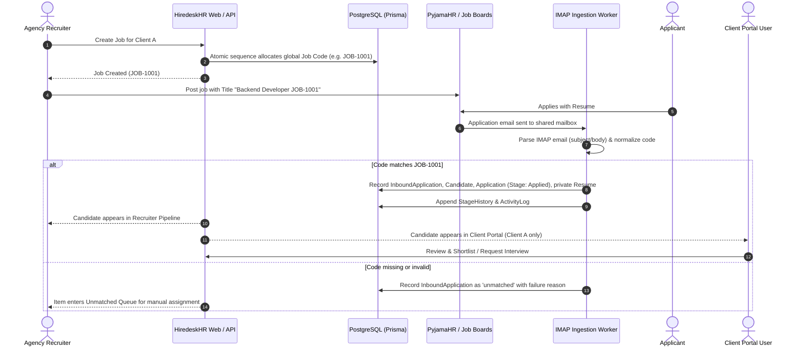

# HiredeskHR — Product Specification

## 1. Product Overview & Mission
**HiredeskHR** is a multi-tenant Applicant Tracking System (ATS) engineered specifically for recruitment agencies managing hiring pipelines across multiple client companies.

### Core Problem
Recruitment agencies work simultaneously on vacancies for dozens of distinct client organizations. Standard corporate ATS platforms assume an internal hiring model with a single tenant and department structure. HiredeskHR provides:
1. Strict multi-tenant isolation where each recruitment agency is an independent tenant organization (`Organization`).
2. Client scoping where client companies (`Client`) access dedicated portals restricted exclusively to their assigned jobs, candidates, and applications.
3. Stable bridge for job board distribution: Recruiter generates an atomic global Job Code (e.g., `JOB-1001`), distributes the job across aggregators (e.g., PyjamaHR -> LinkedIn), and inbound applications received via IMAP are matched to the exact job, candidate, and client pipeline without ambiguity.

---

## 2. User Roles & Permission Matrix
The system defines four initial authorization roles:

| Role | Boundary | Capabilities |
| :--- | :--- | :--- |
| `super_admin` | Platform-wide | Platform configuration, agency tenant onboarding, global audit review. |
| `manager` | Organization | Agency recruiter capabilities plus team management, client onboarding, and approval workflows. |
| `recruiter` | Organization | Manage jobs, candidates, pipelines, stage transitions, recruiter-private notes, resume views, and unmatched queue assignment within their agency tenant. |
| `client` | Organization + Client | Access strictly scoped to their assigned `clientId`. View active jobs for their organization, view allowed candidate profiles, stage reviews, client-visible feedback, and request interviews. Cannot access other clients or agency internal notes. |

---

## 3. End-to-End Recruitment Workflow (MVP Loop)

---

## 4. Feature Specifications

### 4.1 Authentication & Multi-Tenancy
- Powered by Supabase Auth (JWT tokens validated on backend).
- Backend validates JWT and maps `sub` (Auth UUID) to `UserProfile`.
- Every recruitment record belongs to an `organizationId`. Client users are strictly constrained to `organizationId` AND `clientId`.
- Zero cross-tenant leakage.

### 4.2 Job Management & Global Job Codes
- Recruiter creates jobs with fields: title, department, employmentType, workplaceModel, country, currency, salaryRange, experience, openings, deadline, description, requirements, and status (`draft`, `published`, `closed`).
- Sequence-driven atomic code generator: `JOB-1001`, `JOB-1002`, guaranteed globally unique and immutable.
- Copy Job Code shortcut for pasting into job distribution channels.
- Public read-only job detail page for published openings.

### 4.3 Inbound Email Parsing & Worker Service
- Separate persistent Node worker connecting to shared IMAP mailbox (`imapflow` + `mailparser`).
- Extraction order:
  1. Subject line parsed for `JOB-\d+` pattern (normalizing whitespace and dash variants).
  2. Fallback to email body parsing.
- Durable idempotency using mailbox identity + `UIDVALIDITY` + `UID` + `Message-ID`.
- Attachments verified (PDF, DOC, DOCX up to 10MB) and stored in private Supabase Storage.
- Unmatched emails are quarantined in the Unmatched Queue; never silently dropped.

### 4.4 Candidate & Application Pipelines
- Separation between `Candidate` (individual person, normalized email deduplicated per organization) and `Application` (job-specific submission).
- Pipeline stages:
  1. `Applied`
  2. `Screening`
  3. `Shortlisted`
  4. `Interview`
  5. `AI Interview`
  6. `Client Review`
  7. `Selected`
  8. `Hired`
  9. `Rejected`
  10. `Withdrawn`
- Every stage transition logs an append-only `StageHistory` and `ActivityLog`.
- Two-tier notes: Recruiter internal notes (hidden from clients) vs. Client-visible feedback.

### 4.5 Client Portal
- Restricted view for client hiring managers with role `client`.
- Filtered strictly to jobs and applications where `job.clientId == user.clientId` and `job.organizationId == user.organizationId`.
- Non-disclosing `404 Not Found` for any resource requested outside the client's assigned scope (eliminates cross-client ID enumeration).
- Safe Client DTOs:
  - Redacts internal `recruiterNotes` (`undefined`).
  - Redacts private resume storage paths (`storagePath`, `bucket`, `checksum`).
  - Redacts internal activity logs and raw email payloads.
- Authorized private resume access via 60-second expiring signed URLs (`GET /api/client-portal/applications/:id/resume`).
- Client Review Actions:
  - **Shortlist**: Idempotent transition from `Client Review` to `Shortlisted` with atomic `StageHistory` and `ActivityLog`.
  - **Reject**: Rejects candidate with mandatory non-empty reason.
  - **Submit Feedback**: Updates shared `clientFeedback` without touching recruiter notes.
  - **Request Interview**: Persists an auditable `InterviewRequest` entity with `status = 'pending'`. *Critical Guarantee: Does NOT pretend a calendar invitation was sent or meeting was scheduled. Returns honest pending status and notifies agency recruiters.*

### 4.6 Unmatched Application Queue
- Dashboard view for recruiters to inspect inbound emails that failed automatic matching.
- Displays sender, subject, date, attachment status, and failure reason (e.g. `MISSING_JOB_CODE`, `UNKNOWN_JOB_CODE`, `UNSUPPORTED_ATTACHMENT`).
- Recruiter can manually assign the email to an active job; system atomically executes the application ingestion.

### 4.7 Live Dashboard & Metrics
- All dashboard statistics are dynamically computed via SQL/Prisma aggregations:
  - Total Active Jobs, Drafts, Closed
  - Total Applications, New Applications (last 7 days)
  - Candidates by Stage
  - Jobs approaching deadline
  - Recent activity feed
- Absolutely zero hardcoded or simulated mock metrics.

### 4.8 Interview Scheduling & Communications Outbox (Phase 7)
- **Direct Recruiter Scheduling**: Full multi-entity linkage across Organization, Client, Job, Candidate, Application, and Interviewer.
- **Conversion of Client Requests**: Authorized recruiters fulfill pending `InterviewRequest` records into confirmed interviews in an atomic transaction.
- **Server-Side Double-Booking Conflict Prevention**: Rejects any overlapping bookings for the same interviewer with `409 INTERVIEWER_CONFLICT` using interval intersection check (`startAt < existingEndAt && endAt > existingStartAt`).
- **RFC 5545 iCalendar Standards (.ics)**: Pure, standards-compliant `.ics` generation with stable UID (`interview-{id}@hiredeskhr.com`), UTC timestamps, sequence counter increments on reschedule, and `METHOD:REQUEST` / `METHOD:CANCEL`. *Guaranteed honesty: Emits standard .ics calendar files compatible with Google/Apple/Outlook calendars; never falsely claims direct Google/Microsoft OAuth API sync without credentials.*
- **Durable Outbox Pattern (`OutboundCommunication`)**:
  - Outbound emails (invitations, client notices, reschedules, cancellations) are queued transactionally.
  - Nodemailer SMTP delivery with bounded exponential backoff retries.
  - Honest fallback when SMTP variables are omitted (`SMTP_NOT_CONFIGURED` failure status recorded).
  - Manual retry capability for failed outbox entries.
  - Complete XSS prevention via HTML entity escaping for candidate names, jobs, and recruiter notes.
- **Client Portal Isolation**:
  - Client users can view scheduled interviews for their vacancies (`GET /api/client-portal/interviews`).
  - Read-only access: Clients cannot reschedule or cancel internal interviews.
  - Zero leakage guarantee: Internal recruiter preparation notes are redacted (`undefined`).
  - Meeting join URLs and authenticated `.ics` calendar downloads provided.

---

## 5. Scope Boundaries

### MVP & Core Features (Phases 0 - 7 Complete)
- Monorepo scaffold, CI scripts, health checks.
- Supabase Auth, User Profiles, multi-tenant RBAC.
- Jobs CRUD & atomic PostgreSQL Job Code generator.
- Public job views and public application submission.
- Node IMAP ingestion worker with idempotent parsing & unmatched queue.
- Recruiter pipeline, candidate detail, and stage transitions.
- Dedicated client portal with strict tenant isolation and interview request workflows.
- Multi-party interview scheduling, double-booking prevention, RFC 5545 .ics generation, durable SMTP outbox, and audit histories.

### Next Scope (Phase 8+)
- Talent pool global archive search across agency candidate database.
- Transparent AI resume-to-job matching (explainable criteria only).
- Billing, subscription tiers, and multi-mailbox support.

