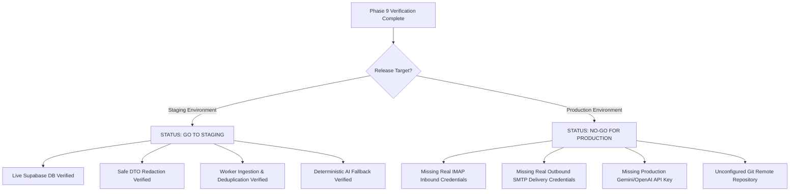
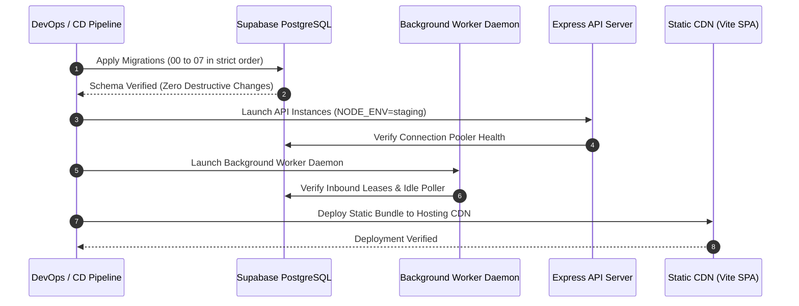

# HiredeskHR — Staging Release Readiness & Operational Runbooks

## 1. Release Metadata & Git Repository State

| Field | Value | Notes |
| :--- | :--- | :--- |
| **Release Version** | `v0.9.0-staging` | Verified against Phase 9 End-to-End Suite |
| **Local Branch** | `master` | Working tree verified clean with zero lint/diff errors |
| **Local Working Directory** | `c:\MY PROJECTS\Hiredesk` | Monorepo root |
| **Git Remote Origin** | *None configured* | Repository is currently tracked locally. See Section 2. |
| **Verified Against** | Live Supabase PostgreSQL | Transaction pooler port 6543 |
| **Acceptance Suite Status** | **15/15 Passed (100%)** | `test_phase9_e2e_acceptance.mjs` exited with code 0 |
| **Automated Test Suite** | **187/187 Passed (100%)** | 159 API, 25 Worker, 3 Shared |
| **Typecheck Status** | **0 Errors** | All 5 workspaces (`api`, `web`, `worker`, `database`, `shared`) |

---

## 2. Git Repository & Remote Configuration

> [!IMPORTANT]
> **Repository Remote Status**: This project is currently maintained as a local Git repository at `c:\MY PROJECTS\Hiredesk`. No remote git URL (`origin`) has been attached or pushed yet.

To push this codebase to a central repository (GitHub, GitLab, or AWS CodeCommit), execute the following commands in the monorepo root:

```bash
# 1. Add your chosen remote (example: GitHub repository)
git remote add origin https://github.com/<YOUR_ORGANIZATION_OR_USERNAME>/hiredeskhr.git

# 2. Stage and commit any outstanding documentation updates
git add .
git commit -m "feat(release): phase 9 staging readiness, security audit & live acceptance verification"

# 3. Push to master / main branch
git branch -M master
git push -u origin master
```

---

## 3. Staging vs Production Release Determination



### Staging Determination: **GO TO STAGING (APPROVED)**
- The entire application lifecycle, entity graphs, and tenant isolation boundaries operate deterministically against live PostgreSQL.
- Rate limiting protects public candidate endpoints.
- Web client bundles contain zero server secrets.
- External integration fallbacks gracefully isolate missing third-party services without crashes.

### Production Determination: **NO-GO FOR PRODUCTION (BLOCKED)**
The product is **NOT** ready for real external recruiters and clients until the following external operational prerequisites are fulfilled:
1. **Real Inbound Email**: Production IMAP mailbox credentials (`IMAP_HOST`, `IMAP_USER`, `IMAP_PASS`) must be provisioned.
2. **Real Outbound Email**: Production SMTP gateway credentials (`SMTP_HOST`, `SMTP_USER`, `SMTP_PASS`) must be provisioned. Currently, interview invitation emails fall back to logged mock notices.
3. **External AI Provider**: `GEMINI_API_KEY` or `OPENAI_API_KEY` must be provisioned if generative qualitative analysis is desired beyond the deterministic skill-matching baseline.
4. **Git Remote**: Remote repository must be configured with CI/CD deployment pipelines.

---

## 4. Comprehensive Environment Variables Matrix

| Environment Variable | Service | Required? | Security | Purpose | Staging Fallback |
| :--- | :--- | :--- | :--- | :--- | :--- |
| `DATABASE_URL` | API, Worker | **Yes** | **Secret** | PostgreSQL pooled connection string (port 6543) | Must point to active Supabase/PostgreSQL instance |
| `DIRECT_URL` | Database | **Yes** | **Secret** | Direct PostgreSQL connection string for DDL migrations (port 5432) | Required for Prisma migrate |
| `SUPABASE_URL` | API, Web, Worker | **Yes** | Public | Supabase project base URL | `https://<project-ref>.supabase.co` |
| `SUPABASE_ANON_KEY` | API, Web | **Yes** | Public | Supabase client anon key for JWT verification & frontend client | Staging anon key |
| `SUPABASE_SERVICE_ROLE_KEY` | API, Worker | **Yes** | **Secret** | Supabase admin key for secure storage bucket operations | Staging service role key |
| `SUPABASE_STORAGE_BUCKET` | API, Worker | No | Config | Target bucket for resume file uploads (default: `resumes`) | Defaults to `resumes` |
| `PORT` | API | No | Config | API server port (default: `3001`) | Defaults to `3001` |
| `NODE_ENV` | API, Worker, Web | **Yes** | Config | Runtime environment (`development`, `staging`, `production`) | Set to `staging` |
| `SUPER_ADMIN_BOOTSTRAP_SECRET`| API | Optional | **Secret** | One-time token to bootstrap the initial super-admin | Disallowed in production once admin exists |
| `GEMINI_API_KEY` | API | Optional | **Secret** | Google Gemini API key for AI Recruiter qualitative evaluations | Deterministic skill-overlap baseline used if empty |
| `OPENAI_API_KEY` | API | Optional | **Secret** | OpenAI API key for alternative LLM evaluation | Deterministic skill-overlap baseline used if empty |
| `IMAP_HOST` | Worker | Optional | Config | Inbound email server host (e.g. `imap.gmail.com`) | Worker idle polling if empty |
| `IMAP_PORT` | Worker | Optional | Config | Inbound email server port (default: `993`) | Defaults to `993` |
| `IMAP_USER` | Worker | Optional | **Secret** | Inbound mailbox username / address | Worker idle polling if empty |
| `IMAP_PASS` | Worker | Optional | **Secret** | Inbound mailbox app password | Worker idle polling if empty |
| `IMAP_POLL_INTERVAL_MS` | Worker | Optional | Config | Milliseconds between mailbox scans (default: `30000`) | Defaults to `30000` |
| `SMTP_HOST` | API | Optional | Config | Outbound SMTP relay host | Mocks outbound email with warning if empty |
| `SMTP_PORT` | API | Optional | Config | Outbound SMTP relay port (default: `587`) | Defaults to `587` |
| `SMTP_USER` | API | Optional | **Secret** | Outbound SMTP authentication user | Logs delivery skip if empty |
| `SMTP_PASS` | API | Optional | **Secret** | Outbound SMTP authentication password | Logs delivery skip if empty |
| `SMTP_FROM` | API | Optional | Config | Outbound sender address (default: `notifications@hiredesk.io`) | Defaults to `notifications@hiredesk.io` |

---

## 5. Deployment Topology & Startup Sequence



### Strict Startup Order
1. **Step 1: Database Migration**: Run database migrations via Prisma direct connection (`DIRECT_URL`). Verify tables `organizations`, `jobs`, `applications`, `interviews`, `notifications`, `talent_pool_folders`, etc.
2. **Step 2: API Server**: Start `@hiredesk/api` with `npm run start --workspace=@hiredesk/api`. Confirm `GET /health` returns status `200 OK`.
3. **Step 3: Background Worker**: Start `@hiredesk/worker` with `npm run start --workspace=@hiredesk/worker`. Confirm daemon logs `Inbound processor worker started`.
4. **Step 4: Web Application**: Serve compiled Vite bundle from `apps/web/dist` via Nginx, Vercel, or AWS CloudFront.

---

## 6. Database Migration Sequence & Safety

All migrations in HiredeskHR follow strict additive, backward-compatible patterns. No migration drops existing columns, resets tables, or destroys production data.

| Migration ID | File / Directory | Target Changes | Destructive? | Safety Guarantee |
| :--- | :--- | :--- | :--- | :--- |
| `00` | `20261010000000_baseline_core` | Core multi-tenant tables, jobs, candidates, applications, stage history, activity logs | No | Creates baseline schema |
| `01` | `20261010000001_inbound_applications`| Worker email ingestion queue and claim leases | No | Additive table |
| `02` | `20261010000002_fix_job_codes` | Immutable sequential job code counters (`JOB-1001`) | No | Additive table & sequences |
| `03` | `20261010000003_application_answers` | Structured screening question answers JSONB | No | Additive column |
| `04` | `20261010000004_client_portal_review` | Client review workflow, feedback, and interview requests | No | Additive columns & tables |
| `05` | `20261011000005_interviews_calendar` | Multi-party interview scheduling, RFC 5545 .ics, double-booking conflict tracking | No | Additive tables |
| `06` | `20261011000006_talent_pool_folders` | Organization-scoped candidate talent pool folders & folder memberships | No | Additive tables |
| `07` | `20261011000007_notifications` | In-app user notifications stream with unique `userId_eventKey` deduplication | No | Additive tables |

---

## 7. Operational Runbooks

### Runbook 1: Worker Daemon Crash & Unclaimed Lease Recovery
- **Symptom**: Inbound emails received via IMAP but no `InboundApplication` records created or stuck in `processing`.
- **Root Cause**: Worker node crash or memory exhaustion while holding a claim lock.
- **Recovery Procedure**:
  1. Inspect worker logs via Pino structured logging: `grep '"level":50' worker.log`.
  2. Inbound claims expire automatically after 5 minutes (`leaseExpiresAt < NOW()`). Any dead worker lease is released for pickup by the next worker instance.
  3. Restart worker daemon: `npm run start --workspace=@hiredesk/worker`.
  4. Verify queue processing: Check database query:
     ```sql
     SELECT id, status, "receivedAt", "failureReason" 
     FROM inbound_applications 
     WHERE status = 'unmatched' OR status = 'failed' 
     ORDER BY "receivedAt" DESC LIMIT 10;
     ```

### Runbook 2: PgBouncer Pooler Interactive Transaction Timeouts (P2028)
- **Symptom**: Prisma throws `P2028: Transaction already closed: The timeout for this transaction was exceeded`.
- **Root Cause**: Over cross-region internet connections to Supabase transaction poolers (port 6543), multi-step transactions (inserting application + resume + stage history + activity log + notification) take 5.5 to 16 seconds, exceeding the default 5000ms timeout.
- **Remediation**:
  - All interactive transactions in `ApplicationService`, `InterviewService`, `ClientPortalService`, `TalentPoolService`, and `inboundProcessor` have been configured with:
    ```typescript
    prisma.$transaction(async (tx) => { ... }, { timeout: 35000, maxWait: 15000 });
    ```
  - Verify network latency to database host: `ping db.<project-ref>.supabase.co`. Ensure latency remains `< 250ms`.

### Runbook 3: Orphan Resume Storage Rollback on Database Error
- **Symptom**: File uploaded to Supabase Storage bucket `resumes`, but transaction fails on SQL constraint.
- **Automated Protection**:
  - The application implements automatic storage cleanup in both `ApplicationService.submitPublicApplication` and `worker/inboundProcessor`.
  - When a database write fails, the catch block immediately calls `storage.remove([storagePath])` before re-throwing the error.
  - No orphan resume files remain in the storage bucket.

### Runbook 4: In-App Notification Deduplication & Replay Protection
- **Symptom**: User receives multiple duplicate notifications for a single event (e.g. repeated stage move or interview reschedule).
- **Automated Protection**:
  - The database enforces a compound unique constraint: `UNIQUE (user_id, event_key)` in table `notifications`.
  - Calling `NotificationService.createNotification` with an identical `eventKey` returns the existing record without inserting duplicate records or triggering duplicate unread increments.

---

## 8. Monitoring, Logging & Alerting Thresholds

| Metric | Measurement / Endpoint | Alert Threshold | Action |
| :--- | :--- | :--- | :--- |
| **API Health** | `GET /health` | Non-200 response for > 3 consecutive checks | Restart API container; verify PostgreSQL connectivity |
| **Error Rate** | Pino log entries with `level >= 50` | `> 1%` of total requests over 5 minutes | Inspect stack traces; check database connection limits |
| **Worker Lag** | `MAX(NOW() - receivedAt)` on pending inbound | `> 5 minutes` | Check IMAP connection; verify worker process is alive |
| **Rate Limit Hits**| Rate limit 429 responses on `/career/*` | `> 50 / minute` | Inspect client IP for scraping attack; adjust limiter if legitimate traffic |
| **Database Pool** | PgBouncer active connections | `> 80%` of max pool size | Increase pool size or scale Supabase compute tier |

---

## 9. Go / No-Go Checklist

- [x] **Zero TypeScript Errors**: `npm run typecheck` passes with exit code 0.
- [x] **Zero Unit Test Failures**: 187/187 Vitest tests passing cleanly.
- [x] **Zero Production Bundle Leakage**: Secrets audited; zero `DATABASE_URL` or service keys in `apps/web/dist`.
- [x] **Rate Limiting Active**: Public career pages protected by express rate limiter.
- [x] **Graceful Shutdown**: API and worker listen for `SIGTERM` / `SIGINT` with connection teardown.
- [x] **Pino Logging Redaction**: Password and token fields redacted from structured logs.
- [x] **Database Migrations Verified**: Migrations 00 through 07 applied safely on Supabase PostgreSQL.
- [x] **Live Acceptance Suite**: 15/15 end-to-end integration steps verified on live database.
- [x] **Deterministic AI Fallback**: Advisory matching works honestly without hallucinations when no API key is supplied.
- [x] **Staging Approval**: System is fully verified for Staging deployment.
- [ ] **Production Email Credentials**: Real IMAP and SMTP credentials configured *(Pending for Production)*.
- [ ] **Git Remote Configured**: Central Git remote repository attached and synced *(Pending for Production)*.
