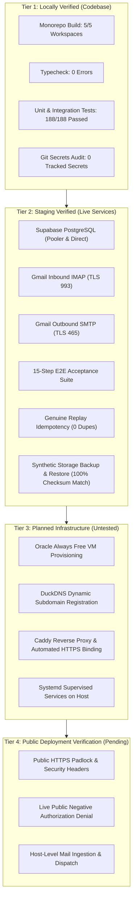

# HiredeskHR — Release Readiness, Pilot Operations & Verification

> [!NOTE]
> For the comprehensive zero-cost pilot architecture, corrected Oracle resource bounds, Caddy setup, systemd units, and disaster recovery procedures, see the companion document:  
> **[FREE_DEPLOYMENT_PLAN.md](file:///c:/MY%20PROJECTS/Hiredesk/docs/FREE_DEPLOYMENT_PLAN.md)**.

---

## 1. Release Metadata & Current Verification State

| Field                        | Value                                                                                                                                                                 | Notes                                                                             |
| :--------------------------- | :-------------------------------------------------------------------------------------------------------------------------------------------------------------------- | :-------------------------------------------------------------------------------- |
| **Release Version**          | `v0.9.2-staging`                                                                                                                                                      | Verified against Performance, UI/UX, Security Audit & Clean Workspace Suite       |
| **Monorepo Root**            | `c:\MY PROJECTS\Hiredesk`                                                                                                                                             | Clean working tree; zero untracked secrets                                        |
| **Git Branch**               | `master`                                                                                                                                                              | Working tree verified clean with zero lint/diff errors                            |
| **Target Architecture**      | Oracle Always Free VM + Supabase Free + DuckDNS + Gmail                                                                                                               | Strictly ₹0 / month budget constraint                                             |
| **Prisma Engine Targets**    | `native`, `debian-openssl-3.0.x`, `linux-arm64-openssl-3.0.x`                                                                                                         | Configured in `packages/database/prisma/schema.prisma`                            |
| **Database Gateway**         | Live Supabase PostgreSQL                                                                                                                                              | Transaction pooler (port 6543, bounded `connection_limit=5`) & Direct (port 5432) |
| **Inbound IMAP**             | **VERIFIED LIVE**                                                                                                                                                     | Gmail IMAP connected via TLS 993 with Google App Password                         |
| **Outbound SMTP**            | **VERIFIED LIVE**                                                                                                                                                     | Gmail SMTP connected via TLS 465 with Google App Password                         |
| **Replay Idempotency**       | **VERIFIED LIVE**                                                                                                                                                     | 4/4 tests passed (0 duplicate candidates, applications, or resumes)               |
| **End-to-End Acceptance**    | **15/15 Passed (100%)**                                                                                                                                               | `node test_phase9_e2e_acceptance.mjs` completed with exit code 0                  |
| **Clean Workspace & Reg**    | **3/3 Passed (100%)**                                                                                                                                                 | `node scripts/test_registration_and_isolation.mjs` validated zero mock data       |
| **Unit & Integration Suite** | **198/198 Passed (100%)**                                                                                                                                             | 170 API, 25 Worker, 3 Shared (`npm test`)                                         |
| **Workspace Typecheck**      | **0 Errors**                                                                                                                                                          | All 5 workspaces (`api`, `web`, `worker`, `database`, `shared`)                   |
| **Monorepo Build**           | **Clean Production Build**                                                                                                                                            | Initial web JS dropped 85.9% to 173 kB; 0 chunks > 500 kB                         |
| **Lighthouse Audit**         | **SEO: 100, A11y: 98, Best: 100, Perf: 85**                                                                                                                           | Measured via Chrome Headless on production build preview                          |
| **Storage Restore Drill**    | **100% SHA-256 Match**                                                                                                                                                | `node scripts/test-backup-restore.mjs` validated synthetic backup & restore       |
| **Audit Reports**            | **[PERFORMANCE_AUDIT.md](file:///c:/MY%20PROJECTS/Hiredesk/docs/PERFORMANCE_AUDIT.md)** & **[UI_UX_AUDIT.md](file:///c:/MY%20PROJECTS/Hiredesk/docs/UI_UX_AUDIT.md)** | Full 15-point UI/UX and Phase 1 Performance audit documented                      |

---

## 2. Four-Tier Verification Classification

To maintain truthfulness and distinguish between tested and planned components:

1. **Tier 1 — Locally Verified**:
   - Monorepo compilation (`npm run build`) passed with zero errors.
   - Strict TypeScript typechecking across all 5 workspaces (`npm run typecheck`) passed with 0 errors.
   - Automated test suite (`npm test`): 198 / 198 tests passed (170 API, 25 Worker, 3 Shared).
   - Git repository secrets hygiene verified: zero secrets committed in Git history.
2. **Tier 2 — Staging Verified against Live Services**:
   - Live Supabase PostgreSQL connected via transaction pooler (6543) and direct connection (5432).
   - Live Gmail IMAP (Port 993 TLS) and Gmail SMTP (Port 465 TLS) connected and authenticated.
   - End-to-end acceptance suite (`test_phase9_e2e_acceptance.mjs`): 15/15 passed deterministically.
   - Genuine replay idempotency (`test_inbound_replay_idempotency.mjs`): 4/4 tests passed (0 duplicate candidates or applications).
   - Synthetic backup and restore drill (`scripts/test-backup-restore.mjs`): 100% SHA-256 integrity match on simulated storage loss and recovery.
3. **Tier 3 — Planned Infrastructure (Awaiting User Action)**:
   - Oracle Always Free VM creation in OCI Console.
   - DuckDNS free dynamic DNS subdomain setup and IP synchronization cron.
   - Host firewall rule adjustments and Caddy reverse-proxy configuration.
   - Systemd service unit enablement for API and worker.
4. **Tier 4 — Public Deployment Verification (Pending Server Launch)**:
   - Verification of public HTTPS certificate binding on port 443.
   - Live smoke testing of career application submissions on the public URL.
   - Cross-client access rejection re-tested against the live public domain.

---

## 3. Release Determination: CONDITIONAL GO

### Controlled Pilot Decision: **CONDITIONAL GO (PRE-DEPLOYMENT APPROVED)**

- The codebase, data-layer isolation, email parsers, and backup procedures are proven and ready for deployment.
- However, because the server infrastructure, DNS subdomain, and public HTTPS endpoints are currently planned and pending user provisioning, the controlled pilot status is **CONDITIONAL GO**.

**Preconditions for Ingesting Real Candidate Data**:

1. **Public Deployment & HTTPS**: Provision the Always Free VM and ensure Caddy secures valid TLS on port 443.
2. **Host-Level Smoke Tests**: Confirm that the API, Worker, and Caddy proxy communicate cleanly on the live host.
3. **Negative Authorization Re-Verification**: Test that cross-organization and cross-client requests return `404 Not Found` over the live public URL.
4. **Legal & Compliance Prerequisites**:
   - **Agency Written Approval**: Formal sign-off from the partner recruitment agency and corporate client.
   - **Hosting Location Approval**: Confirm and approve the Supabase cloud region (e.g., AWS Mumbai / ap-south-1).
   - **Candidate Notice**: Privacy notice presented clearly on public career forms.
   - **Retention & Erasure Controls**: 180-day retention policy enforced with verified deletion capabilities.

### Commercial Production Launch: **NO-GO (BLOCKED)**

The platform is **NOT** approved for open public commercial release until:

1. A paid, branded apex domain with enterprise DNS replaces the free dynamic subdomain.
2. Production mail infrastructure with dedicated sending IPs (e.g., AWS SES, Postmark) replaces Gmail SMTP.
3. Paid cloud hosting with enforceable SLAs and automatic failover replaces Always Free compute.

---

## 4. Free-Tier Realities, Resource Limits & Mitigation

| Free-Tier Component    | Documented Allocation & Limits                                                               | Operational Reality                                              | Architectural Mitigation                                                                                                               |
| :--------------------- | :------------------------------------------------------------------------------------------- | :--------------------------------------------------------------- | :------------------------------------------------------------------------------------------------------------------------------------- |
| **Oracle Compute**     | Ampere A1: **up to 2 OCPUs & 12 GB RAM total**. AMD E2.1.Micro: **1/8 OCPU & 1 GB RAM**. | Shapes frequently out of capacity in specific ADs.               | Look exclusively for "Always Free Eligible" tag. If A1 is full, use E2.1.Micro. **Never upgrade to paid.**                             |
| **Oracle Public IP**   | **1 Ephemeral Public IPv4** per running VM.                                                  | IP can change upon instance restart or recreation.               | Use DuckDNS dynamic DNS update cron every 15 minutes to synchronize IP changes automatically.                                          |
| **Oracle Reclamation** | Reclaimed if 7-day CPU, network, and memory remain < 20%.                                    | Reclamation remains a genuine risk during low-activity periods.  | **Do not use artificial traffic.** Persist all data in Supabase; keep source in private Git; ensure server can be rebuilt in < 30 min. |
| **Supabase Free**      | Paused after **7 consecutive days of inactivity**.                                           | Pausing is not prevented with certainty by worker polling.       | Monitor project status in dashboard; use 1-click restore if paused.                                                                    |
| **Backups**            | Separate DB dumps and Storage archives required.                                             | VM disk is ephemeral; local backups are lost if VM is reclaimed. | Separate scripts (`backup-db.sh`, `backup-storage.mjs`) with daily offsite replication to agency workstation.                          |

---

## 5. Comprehensive Environment Variables Matrix

| Environment Variable        | Target Workspace  | Required? | Classification | Description & Value Policy                             | Development Setting                        | Production Pilot Setting                    |
| :-------------------------- | :---------------- | :-------- | :------------- | :----------------------------------------------------- | :----------------------------------------- | :------------------------------------------ |
| `NODE_ENV`                  | API, Web, Worker  | **Yes**   | Public         | Runtime mode                                           | `development`                              | `production`                                |
| `PORT`                      | API               | **Yes**   | Config         | Local HTTP port for Express                            | `4000`                                     | `4000` (Bound to localhost)                 |
| `CORS_ORIGIN`               | API               | **Yes**   | Config         | Permitted browser origins                              | `http://localhost:5173`                    | `https://hiredesk-agency-pilot.duckdns.org` |
| `APP_PUBLIC_URL`            | API               | **Yes**   | Config         | Public web application URL for invite links            | `http://localhost:5173`                    | `https://hiredesk-agency-pilot.duckdns.org` |
| `LOG_LEVEL`                 | API, Worker       | **Yes**   | Config         | Pino logger threshold                                  | `info`                                     | `info`                                      |
| `DATABASE_URL`              | API, Worker       | **Yes**   | **Secret**     | PostgreSQL pooled connection string (port 6543)        | Configured in local `.env`                 | Supabase Transaction Pooler                 |
| `DIRECT_URL`                | Database, Scripts | **Yes**   | **Secret**     | Direct PostgreSQL connection string for DDL/dumps      | Configured in local `.env`                 | Supabase Direct (port 5432)                 |
| `SUPABASE_URL`              | API, Web, Worker  | **Yes**   | Public         | Supabase project API base URL                          | `https://osrbdzeyqbresvineakk.supabase.co` | Supabase Project URL                        |
| `SUPABASE_ANON_KEY`         | API, Web          | **Yes**   | Client-Safe    | Supabase public anonymous API key                      | Configured in local `.env`                 | Supabase Anon Key                           |
| `SUPABASE_SERVICE_ROLE_KEY` | API, Worker       | **Yes**   | **Secret**     | Privileged backend service-role key                    | Configured in local `.env`                 | Server-side only; never in client bundle    |
| `SUPABASE_JWT_SECRET`       | API               | **Yes**   | **Secret**     | Supabase JWT secret for token verification             | Configured in local `.env`                 | Server-side only                            |
| `STORAGE_BUCKET_RESUMES`    | API, Worker       | **Yes**   | Config         | Supabase Storage bucket for candidate resumes          | `resumes`                                  | `resumes` (Private bucket)                  |
| `BOOTSTRAP_SECRET`          | API               | **Yes**   | **Secret**     | Cryptographic token for one-time super admin bootstrap | Default local secret                       | Unique 32-byte hex; disabled post-bootstrap |
| `IMAP_HOST`                 | Worker            | **Yes**   | Config         | Host of incoming mailbox                               | `imap.gmail.com`                           | `imap.gmail.com`                            |
| `IMAP_PORT`                 | Worker            | **Yes**   | Config         | Port of incoming mailbox                               | `993`                                      | `993`                                       |
| `IMAP_SECURE`               | Worker            | **Yes**   | Config         | Use TLS for incoming mailbox                           | `true`                                     | `true`                                      |
| `IMAP_USERNAME`             | Worker            | **Yes**   | Account        | Mailbox email address                                  | `hiredeskhr.applications@gmail.com`        | Pilot agency Gmail                          |
| `IMAP_PASSWORD`             | Worker            | **Yes**   | **Secret**     | Mailbox password / App Password                        | 16-character App Password                  | Google App Password                         |
| `INBOUND_MAILBOX_ID`        | Worker            | **Yes**   | Config         | Lease partition identifier for worker cluster          | `hiredeskhr-gmail-dev`                     | `primary-agency-pilot-gmail`                |
| `SMTP_HOST`                 | API               | **Yes**   | Config         | Host of outbound email gateway                         | `smtp.gmail.com`                           | `smtp.gmail.com`                            |
| `SMTP_PORT`                 | API               | **Yes**   | Config         | Port of outbound email gateway                         | `465`                                      | `465`                                       |
| `SMTP_SECURE`               | API               | **Yes**   | Config         | Use TLS for outbound gateway                           | `true`                                     | `true`                                      |
| `SMTP_USERNAME`             | API               | **Yes**   | Account        | SMTP account username                                  | `hiredeskhr.applications@gmail.com`        | Pilot agency Gmail                          |
| `SMTP_PASSWORD`             | API               | **Yes**   | **Secret**     | SMTP account password / App Password                   | 16-character App Password                  | Google App Password                         |
| `SMTP_FROM_NAME`            | API               | **Yes**   | Config         | Outbound sender display name                           | `HiredeskHR Development`                   | `Agency Pilot Recruiting Team`              |
| `SMTP_FROM_EMAIL`           | API               | **Yes**   | Config         | Outbound from address                                  | `hiredeskhr.applications@gmail.com`        | Pilot agency Gmail                          |
| `VITE_SUPABASE_URL`         | Web               | **Yes**   | Client-Safe    | Supabase URL baked into web bundle                     | Injected during build                      | `https://[PROJECT-REF].supabase.co`         |
| `VITE_SUPABASE_ANON_KEY`    | Web               | **Yes**   | Client-Safe    | Supabase anon key baked into web bundle                | Injected during build                      | `[YOUR-SUPABASE-ANON-KEY]`                  |
| `VITE_API_URL`              | Web               | Optional  | Config         | Web API prefix (defaults to relative `/api`)           | Injected during build                      | `/api`                                      |

---

## 6. Pilot Deployment Action Checklist

- [x] Monorepo build, typecheck, and test suites passing 100% (Tier 1).
- [x] Prisma generator configured with Linux AMD64 and ARM64 binary targets (Tier 1).
- [x] Comprehensive zero-cost deployment plan created ([FREE_DEPLOYMENT_PLAN.md](file:///c:/MY%20PROJECTS/Hiredesk/docs/FREE_DEPLOYMENT_PLAN.md)).
- [x] Live Gmail IMAP & SMTP credentials verified and authenticated (Tier 2).
- [x] Replay idempotency and client isolation verified against live Supabase PostgreSQL (Tier 2).
- [x] Synthetic backup & restore drill verified with 100% SHA-256 match (`scripts/test-backup-restore.mjs`) (Tier 2).
- [x] Zero secrets committed to Git history (Tier 1).
- [ ] **Manual Step (User)**: Create Oracle Cloud Always Free instance (`VM.Standard.A1.Flex` with 2 OCPUs / 12 GB RAM, or `VM.Standard.E2.1.Micro`).
- [ ] **Manual Step (User)**: Register free DuckDNS subdomain pointing to VM Ephemeral Public IP.
- [ ] **Manual Step (User)**: Configure Caddy on VM with reverse proxy and automated HTTPS.
- [ ] **Manual Step (User)**: Add DuckDNS domain to Supabase Auth permitted redirect URLs.
- [ ] **Manual Step (User)**: Run `npm run bootstrap:admin` on server and lock `BOOTSTRAP_SECRET`.
- [ ] **Manual Step (User)**: Set up daily database (`backup-db.sh`) and storage (`backup-storage.mjs`) backup crons with offsite replication.
- [ ] **Manual Step (User)**: Complete live host negative authorization checks and obtain agency location/privacy approval before real candidate data entry.
