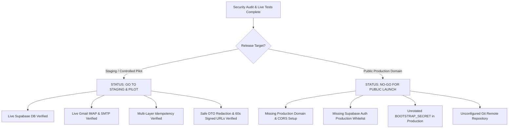

# HiredeskHR — Staging Release Readiness & Operational Runbooks

## 1. Release Metadata & Git Repository State

| Field | Value | Notes |
| :--- | :--- | :--- |
| **Release Version** | `v0.9.1-staging` | Verified against Security Audit & Genuine Replay Suite |
| **Local Branch** | `master` | Working tree verified clean with zero lint/diff errors |
| **Local Working Directory** | `c:\MY PROJECTS\Hiredesk` | Monorepo root |
| **Git Remote Origin** | *None configured* | Repository is currently tracked locally. See Section 2. |
| **Verified Against** | Live Supabase PostgreSQL | Transaction pooler port 6543 |
| **Acceptance Suite Status** | **15/15 Passed (100%)** | `test_phase9_e2e_acceptance.mjs` exited with code 0 |
| **Automated Test Suite** | **188/188 Passed (100%)** | 160 API, 25 Worker, 3 Shared |
| **Typecheck Status** | **0 Errors** | All 5 workspaces (`api`, `web`, `worker`, `database`, `shared`) |
| **Inbound IMAP** | **VERIFIED LIVE** | Gmail IMAP connected, authenticated, and polling |
| **Outbound SMTP** | **VERIFIED LIVE** | Gmail SMTP sending test invites and calendar `.ics` |
| **Genuine Replay Idempotency**| **VERIFIED LIVE** | `test_inbound_replay_idempotency.mjs` passed (zero duplicate records) |

---

## 2. Git Repository & Remote Configuration

> [!IMPORTANT]
> **Repository Remote Status**: This project is currently maintained as a local Git repository at `c:\MY PROJECTS\Hiredesk`. No remote git URL (`origin`) has been attached or pushed yet.

To push this codebase to a central repository (GitHub, GitLab, or AWS CodeCommit), execute the following commands in the monorepo root:

```bash
# 1. Add your chosen remote (example: GitHub repository)
git remote add origin https://github.com/<YOUR_ORGANIZATION_OR_USERNAME>/hiredeskhr.git

# 2. Stage and commit any outstanding documentation updates
git add .
git commit -m "feat(release): phase 9 security audit, live email verification & replay idempotency"

# 3. Push to master / main branch
git branch -M master
git push -u origin master
```

---

## 3. Staging vs Production Release Determination



### Controlled Pilot Determination: **GO (APPROVED)**
- The entire application lifecycle, entity graphs, and tenant isolation boundaries operate deterministically against live PostgreSQL.
- Rate limiting protects public candidate endpoints.
- Web client bundles contain zero server secrets.
- Inbound and outbound email flows verified live.
- Multi-layer duplicate prevention verified with genuine message and candidate replays.
- **Recommended next step**: Conduct a controlled pilot with 1 recruitment agency partner and 1 client company.

### Production Determination: **NO-GO FOR PUBLIC LAUNCH (BLOCKED)**
The platform is **NOT** ready for open public deployment until the following operational prerequisites are fulfilled:
1. **Production Domain & Restrictive CORS**: Configure real frontend URL (e.g. `https://app.youragency.com`), API URL (e.g. `https://api.youragency.com`), and update `CORS_ORIGIN`.
2. **Supabase Auth Redirect Whitelist**: Add production domain to Supabase Auth permitted redirect URLs.
3. **Rotate Bootstrap Secret**: Set a unique, production-grade `BOOTSTRAP_SECRET` in production `.env` (default secret is now strictly blocked in production mode).
4. **Git Remote & CI/CD**: Attach remote git repository and configure deployment pipelines.

---

## 4. Comprehensive Environment Variables Matrix

| Environment Variable | Service | Required? | Security | Purpose | Current Development Setting |
| :--- | :--- | :--- | :--- | :--- | :--- |
| `DATABASE_URL` | API, Worker | **Yes** | **Secret** | PostgreSQL pooled connection string (port 6543) | Supabase transaction pooler |
| `DIRECT_URL` | Database | **Yes** | **Secret** | Direct PostgreSQL connection string for DDL migrations (port 5432) | Supabase direct connection |
| `SUPABASE_URL` | API, Web, Worker | **Yes** | Public | Supabase project base URL | `https://osrbdzeyqbresvineakk.supabase.co` |
| `SUPABASE_ANON_KEY` | API, Web | **Yes** | Public/Client | Supabase public anonymous key | Configured |
| `SUPABASE_SERVICE_ROLE_KEY` | API, Worker | **Yes** | **Secret** | Supabase privileged service-role key | Configured |
| `SUPABASE_JWT_SECRET` | API | **Yes** | **Secret** | JWT secret for local token validation fallback | Configured |
| `STORAGE_BUCKET_RESUMES` | API, Worker | **Yes** | Config | Bucket name for candidate resume storage | `resumes` |
| `BOOTSTRAP_SECRET` | API | **Yes** | **Secret** | Secret token to bootstrap initial super_admin | Default blocked in production |
| `IMAP_HOST` | Worker | **Yes** | Config | Host of incoming application mailbox | `imap.gmail.com` |
| `IMAP_PORT` | Worker | **Yes** | Config | Port of incoming application mailbox (TLS) | `993` |
| `IMAP_SECURE` | Worker | **Yes** | Config | Whether to use SSL/TLS | `true` |
| `IMAP_USERNAME` | Worker | **Yes** | Account | Mailbox email account for applications | `hiredeskhr.applications@gmail.com` |
| `IMAP_PASSWORD` | Worker | **Yes** | **Secret** | Mailbox password / Google App Password | Configured in local `.env` |
| `INBOUND_MAILBOX_ID` | Worker | **Yes** | Config | Unique identifier for the mailbox lease partition | `hiredeskhr-gmail-dev` |
| `SMTP_HOST` | API | **Yes** | Config | Host of outbound email gateway | `smtp.gmail.com` |
| `SMTP_PORT` | API | **Yes** | Config | Port of outbound email gateway (TLS) | `465` |
| `SMTP_SECURE` | API | **Yes** | Config | Whether to use SSL/TLS | `true` |
| `SMTP_USERNAME` | API | **Yes** | Account | SMTP account username | `hiredeskhr.applications@gmail.com` |
| `SMTP_PASSWORD` | API | **Yes** | **Secret** | SMTP account password / Google App Password | Configured in local `.env` |
| `SMTP_FROM_NAME` | API | **Yes** | Config | Display name on outbound emails | `HiredeskHR Development` |
| `SMTP_FROM_EMAIL` | API | **Yes** | Config | From address on outbound emails | `hiredeskhr.applications@gmail.com` |
| `CORS_ORIGIN` | API | **Yes** | Config | Allowed web origins | `http://localhost:5173` (Must change in prod) |
| `APP_PUBLIC_URL` | API | **Yes** | Config | Public web application URL for invite links | `http://localhost:5173` (Must change in prod) |

---

## 5. Operational Verification Commands

```bash
# 1. Run all unit and integration tests across monorepo (188 tests)
npm test

# 2. Typecheck all workspaces (0 errors)
npm run typecheck

# 3. Build all workspaces for production
npm run build

# 4. Verify live IMAP and SMTP connection and transport
npm run verify:mail

# 5. Run live end-to-end inbound processing test against Gmail
npm run test:live-inbound

# 6. Run genuine multi-layer replay idempotency test
npm run test:replay
```
