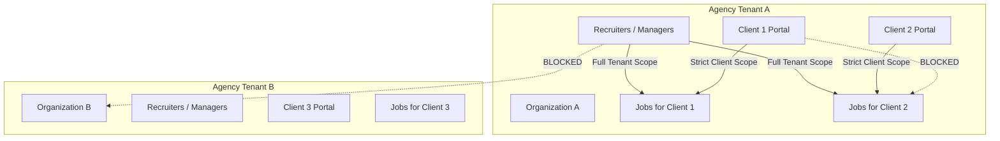
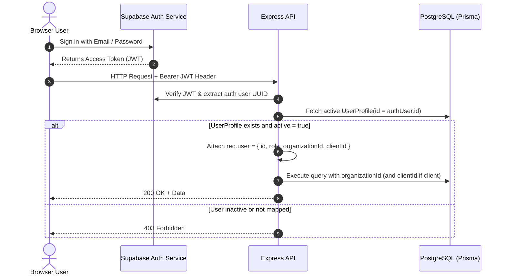

# HiredeskHR — Security & Isolation Model

## 1. Multi-Tenant Isolation Architecture

HiredeskHR enforces strict multi-tenancy at two hierarchical levels:
1. **Organization Boundary (Top Level)**: Represents the recruitment agency. No recruiter, manager, or client from Agency A can read or write any record belonging to Agency B.
2. **Client Boundary (Sub-Tenant Level)**: Represents a client company of the recruitment agency. Client portal users can only access jobs, candidates, and applications associated with their assigned `clientId`.



---

## 2. Authentication & Session Resolution



### Authorization Context Contract (`req.user`)
```typescript
interface AuthenticatedUser {
  id: string;               // UUID mapped to UserProfile.id
  authUserId: string;       // Supabase Auth sub UUID
  email: string;
  role: 'super_admin' | 'manager' | 'recruiter' | 'client';
  organizationId: string;   // Required for all roles except super_admin
  clientId?: string | null; // Set if role === 'client'
}
```

---

## 3. Database Security & Authorization Enforcement

### Prisma Scoping Policy
Because Prisma executes queries via a direct database connection pool, application-level query scoping is our primary defense-in-depth:
- Every query in services/repositories must include `where: { organizationId: req.user.organizationId }`.
- If `req.user.role === 'client'`, the query must also filter `where: { clientId: req.user.clientId }`.
- Route parameters (`/jobs/:id`, `/applications/:id`) must never be trusted without verifying the entity's `organizationId` and `clientId` against `req.user`.

### Row Level Security (RLS) on PostgreSQL
For tables accessed via direct Supabase client connections or public extensions:
- RLS is enabled (`ALTER TABLE ... ENABLE ROW LEVEL SECURITY;`).
- Supabase Storage policies ensure only service-role can read/write raw objects, preventing public resume leaks.

---

## 4. Resume & Document Storage Security

1. **Bucket Configuration**:
   - Bucket name: `resumes`.
   - Access: **Private only** (`public = false`). Direct public URLs return 403.
2. **Object Key Strategy**:
   - Paths use UUIDs, never predictable candidate names:
     `resumes/{organizationId}/{candidateId}/{randomUUID}.{ext}`
3. **Authorized Download / Preview Endpoint**:
   - `GET /api/applications/:id/resume`
   - Express verifies caller has permission to view the application.
   - For client users, verifies `application.clientId === req.user.clientId`.
   - Generates a short-lived signed URL (60-second expiration) or securely streams the file buffer.

---

## 5. Input Validation & Defense-in-Depth

- **Zod Validation**: Applied to `body`, `query`, and `params` before reaching any route handler.
- **Helmet**: Secures response headers (`X-Content-Type-Options: nosniff`, `X-Frame-Options: DENY`, `Strict-Transport-Security`).
- **CORS**: Whitelist restricted to configured frontend domains.
- **Rate Limiting**:
  - Global API: 300 requests / 15 minutes.
  - Public career application endpoint: 10 requests / 15 minutes per IP.
  - Auth endpoints: 20 requests / 15 minutes.
- **File Upload Protection**:
  - Whitelist: `application/pdf`, `application/msword`, `application/vnd.openxmlformats-officedocument.wordprocessingml.document`.
  - Max file size: 10 MB.
  - Magic byte validation to prevent disguised executable payloads.

---

## 6. Secrets Management

- Zero credentials committed to git.
- `.env` files are in `.gitignore`.
- `.env.example` provides complete documentation of required variables with empty/dummy values.
- Centralized `config.ts` validates required environment variables at server startup using Zod.

---

## 7. Notes Separation & Stage Transition Access Control

### 7.1 Hard Separation of Recruiter Notes
1. **Recruiter Internal Notes (`recruiterNotes`)**:
   - Strictly reserved for internal agency recruiters and managers.
   - For any API request authenticated as `role === 'client'`, `recruiterNotes` is unconditionally redacted and stripped from the returned object (`undefined`).
   - If a client user attempts to submit or modify `recruiterNotes` via `PATCH /api/applications/:id/notes`, the API immediately aborts with `403 Forbidden` (`FORBIDDEN`).
2. **Client Feedback (`clientFeedback`)**:
   - Bi-directionally visible to both client users and internal agency recruiters.
   - Client users can submit reviews, ratings, and feedback on candidates assigned to their client organization.
   - Creates an `ActivityLog` record marked `visibility: 'client_visible'`.

### 7.2 Stage Transition Authorization Matrix
1. **Recruiters & Managers**:
   - Can transition applications across any valid canonical stage (`Applied`, `Screening`, `Shortlisted`, `Interview`, `AI Interview`, `Client Review`, `Selected`, `Hired`, `Rejected`, `Withdrawn`) within their organization.
2. **Clients**:
   - Cannot make unrestricted recruiter-level stage movements.
   - Can only transition applications that are currently in the `Client Review` stage (e.g. approving to shortlist or returning feedback). Transitions on any other stage return `403 Forbidden`.
3. **Atomic Persistence Guarantee**:
   - Stage transitions write `Application.stage`, `StageHistory`, and `ActivityLog` in a single PostgreSQL `$transaction`.
   - If any step fails, the entire transaction rolls back, preventing orphaned history or stale state.

